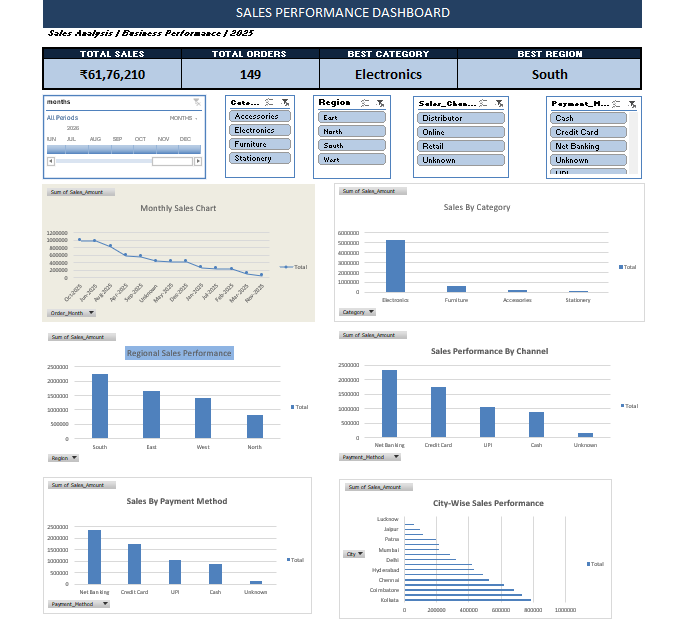

#  Sales Performance Dashboard using Microsoft Excel

## 1. Project Overview

This project focuses on analyzing sales data and developing an interactive Sales Performance Dashboard using Microsoft Excel.

The dashboard provides insights into sales performance across product categories, regions, cities, sales channels, payment methods, and monthly trends.

## 2. Project Objectives

* Analyze overall sales performance.
* Identify the highest-performing product category.
* Compare regional and city-wise sales.
* Analyze sales channel performance.
* Understand payment method preferences.
* Track monthly sales trends.
* Build an interactive business dashboard.

## 3. Tools & Technologies

* Microsoft Excel
* Excel Tables
* Excel Formulas
* Data Cleaning
* PivotTables
* PivotCharts
* Slicers
* Timeline

## 4. Data Cleaning

The dataset was cleaned and prepared before analysis.

Key activities:

* Identified and removed duplicate Order IDs.
* Handled missing values using "Unknown".
* Corrected inconsistent text values.
* Corrected invalid quantity entries.
* Identified and handled invalid dates.
* Verified numerical sales values.
* Checked data consistency.

## 5. Dashboard Features

### KPI Cards

* Total Sales
* Total Orders
* Best-Selling Category
* Best-Performing Region

### Charts

* Monthly Sales Trend
* Category-wise Sales
* Regional Sales Performance
* Sales Channel Performance
* Payment Method Analysis
* City-wise Sales Performance

### Interactive Filters

* Region
* Category
* Sales Channel
* Payment Method
* Monthly Timeline

All filters are connected to the PivotTables to provide interactive analysis.

## 6. Key Business Insights

| Metric              |       Result |
| ------------------- | -----------: |
| Total Sales         |   ₹61,76,210 |
| Total Orders        |          149 |
| Best Category       |  Electronics |
| Best Region         |        South |
| Top City            |      Kolkata |
| Top Sales Channel   |       Retail |
| Top Payment Method  |  Net Banking |
| Highest Sales Month | October 2025 |

### Additional Findings

* Electronics contributed approximately 85.54% of total sales.
* South contributed approximately 36.60% of total sales.
* Retail contributed approximately 38.85% of total sales.
* October 2025 contributed approximately 16.04% of total sales.

## 7. Project Files

| File                            | Description                                                                                                |
| ------------------------------- | ---------------------------------------------------------------------------------------------------------- |
| Sales_Performance_Analysis.xlsx | Complete Excel workbook containing raw data, cleaned data, analysis, PivotTables and interactive dashboard |
| Dashboard_Screenshot.png        | Dashboard preview (to be added)                                                                            |

## 8. Skills Learned

* Data cleaning and preprocessing.
* Excel Tables and formulas.
* PivotTable-based analysis.
* Interactive dashboard development.
* Data visualization.
* Extracting business insights.

## 9. Author

**Aspiring Data Analyst | Future Data Scientist**

GitHub: [@amar1008tech](https://github.com/amar1008tech)

---

**Project Status:** Completed ✅
